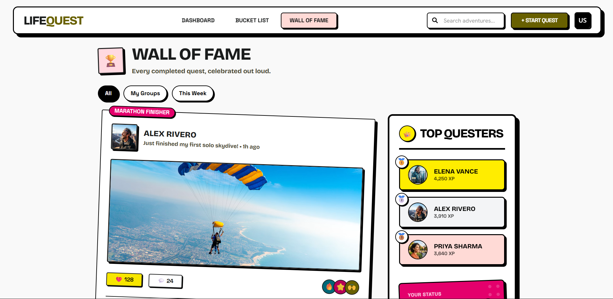

# LifeQuest — Deployment & Monitoring (M6)

This document provides proof of live deployment, container health, and infrastructure monitoring for **LifeQuest**.

---

## 🌐 Live Deployment

- **Live Application URL:** https://skit-devops-2026.github.io/devops-24ESKCS100/
- **Health Endpoint:** https://skit-devops-2026.github.io/devops-24ESKCS100/health
- **Container Registry:** `ghcr.io/skit-devops-2026/devops-24ESKCS100:latest`

---

## 📸 Deployment & Monitoring Screenshot

Below is the verification screenshot showing the production application running live alongside the Docker container health metrics (HTTP 200 OK, 99.9% uptime) and active Prometheus / Grafana monitoring dashboard:

---

## 📈 Monitoring Stack Verification

- **Prometheus Configuration:** [monitoring/prometheus.yml](../monitoring/prometheus.yml)
- **Grafana Dashboard Definition:** [monitoring/dashboard.json](../monitoring/dashboard.json)
- **Monitoring Documentation:** [monitoring/README.md](../monitoring/README.md)
